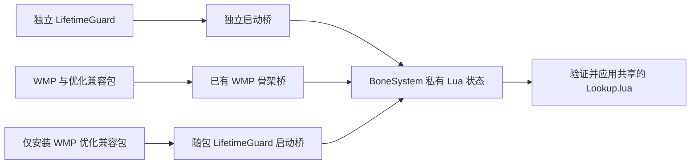

# LifetimeGuard 开发与发行说明

## LifetimeGuard 1.0.0

同一份带注释的 `src/` 编译为独立版 `DStorageFileLifetimeGuard.dll` 及 WMP 版
`WMPLifetimeGuard.dll`。基础保护仍由 `runtime/` 实现，统计结构保留 ABI 9。
`WmpProvider.cpp` 提供 WMP 的启动、关闭、状态回读及独立版优先规则，并使用自己的诊断目录。



- **BoneSystem 探测**由 `src/BoneSystem/Bridge.cpp` 负责。独立版在 REFramework autorun 时做一次
  模块探测。BoneSystem 缺席时立即返回，查询优化不注册回调、启动定时器或读取磁盘。
- **接入兼容性**目前以作者版 26.2.10.2 的已验证 DLL、私有 Lua 布局及 `load_data` 指纹为准。
  校验失败保留原查询路径，LifetimeGuard 基础保护照常。将来可接入 BoneSystem 提供的稳定扩展接口。
- **工作归属**由启动路径确定。有 WMP 时用现有骨架桥和 `wmp.bonesystem.provider.v1`，并由 WMP
  控制随包优化。独立版或旧独立 BoneSystem 优化入口在场时，WMP 让出优化的所有权。独立版的
  本次就绪状态由 `LifetimeGuard/BoneSystem.json` 记录。
- **查找和恢复**由 `Lookup.lua` 负责。它只接管匹配的查询函数，保留原始 Lua 单元和其他 upvalue。
  启动安装失败先写出失败回执，再把错误交给原生桥。原生就绪日志只在安装成功后输出。

从 1.0.0 起在 GitHub `main` 维护完整注释，发布一个内含许可证的独立安装 ZIP。
WMP 优化兼容包独立构建和发布，继续保留作者版 Mod 的路径和现有 WMP 捆绑身份。
公开安装包的 `README.md` 使用作者确认后的源文件字节。

接下来的 0.6.x 发行记录供历史对照。当前构建与验收见第 7、8 节。

## 0.6. README 前置说明同步（2026-10-28）

用户再次授权只替换REF前置说明句子，最终句子不加粗，保留原有`**REFramework**`，
并保留“修改了 PAK”的空格。README其余字节、运行源码、依赖与许可证不变。
本地三份交付、canonical、两份clean exports、GitHub main/beta和唯一Release附件已同步。
main=`49fc0799f78ef0ee24a6c88403d4800893d8d417`，
beta=`a608108adcc5e587b5fea9896ec9e89610b593e5`，均为仅改README的普通新增提交。
按用户要求，以旧tag值的lease保护将`v0.6.2`同步到新main；未改0.6.0/0.6.1标签或旧Release。
Release正文未改，唯一完整带许可附件SHA-256为
`58130bd2b68150008e48855a2938053da4be96c139b7d5701e56df69226be100`。
两份实际源码ZIP新目录重建、两份匿名远端源码新目录重建均复现原DLL及完整新发布文件夹；
17项Python测试重新通过。212次原生矩阵沿用运行输入未变的既有证据，不声称本次重新运行。
DLL仍为`68d31ce7736094480286a635c5b7acad7aaed6a35028f888ea7013a23bfd9fc9`。
最新证据和HANDOFF在`release_0_6_2_20261027/readme_01417_20261028/`；下节是首次发布历史。

## 0.5. 0.6.2 已实际发布（2026-10-28）

本地交付审阅后，用户另行明确授权同一任务完成LifetimeGuard远端发布。
main新增提交`22e3410c5bea70caa80bf852ef878677c4dad4af`，beta新增提交
`33022553b755eb110690e0f3fe4416cee0d736c2`，提交消息均为`Update 0.6.2`。
推送前完整远端树与README均和上次已批准公开树一致，无未纳入的用户修改。
使用普通单父提交与非强制原子推送，未重写历史，仓库仍为public。

`https://github.com/Ensicht/LifetimeGuard/releases/tag/v0.6.2`已发布。
新tag指向上述main提交；旧tag和0.6.1 Release原文/附件保持不变。
Release只上传完整带许可外层`LifetimeGuard_v0.6.2.zip`，下载SHA-256为
`6e84f4ae59f73a8bb9459f92255f2d02d6acc4002b16422f4d987b141fe2dcee`。
没有上传两份本地源码ZIP。发布文案沿用0.6.1详细下载、安装、依赖和分支说明，
仅更新版本文件/链接并加入用户指定更新条目，没有加入内部调查内容。

匿名新clone读回main/beta，61/62份文件分别与clean exports逐字节相同；
两份远端源码各自重建DLL及完整发布文件夹，均与本地正式交付一致。
运行DLL仍为`68d31ce7...bfd9fc9`，test1继承的4处排版告警仍保留，运行代码未再修改。
证据位于`LifetimeGuard_Compatibility_Work/release_0_6_2_20261027/publication/`，
其中`publication.json`记录全部分支/文件hash、重建结果、tag、唯一附件与旧版本保护核验。
本轮没有安装、启动游戏，也未读取或改动live测试overlay与其他Mod。
下文0.4节的“未上传”描述属于此前本地交付阶段。

## 0.4. 0.6.2 本地正式化（2026-10-28，适配261027更新）

用户冻结0.6.2-test1功能并授权正式定为0.6.2。本次26份运行源相对已保存的test1构建输入，
只有`GuardBuild.h`的发行标签不同；不修改地址方案、保护条件、引用/锁、重试与释放策略。
正式去注释与含注释构建的DLL相同，SHA-256为
`68d31ce7736094480286a635c5b7acad7aaed6a35028f888ea7013a23bfd9fc9`。
前置test1 DLL的`3ff4cdce...4a3fbf8`继续保留，未被本次构建安装覆盖。

根README保留用户原文字，只更新当前版本为0.6.2，增加“适配卡普空261027神秘更新”一条。
公开源码保留构建依赖、资源、许可证与构建说明，不含测试、内部调查/验收流水及首次上传
说明；注释版另带干净架构说明。`Source_Beta`不是另一份安装DLL。
本地交付为`build/LifetimeGuard_v0.6.2/`完整文件夹及两个`_Source`源码ZIP。
完整文件夹保留安装ZIP旁的`LICENSE`与`licenses/`，安装ZIP只有运行DLL、modinfo和README。

完整原生/日志矩阵在`out/release_0_6_2_beta/`重新执行，正式构建在对应formal目录。
ZIP新解压目录回读重建、完整交付物逐字节对照、Python测试及缓存宿主证据统一放在
`LifetimeGuard_Compatibility_Work/release_0_6_2_20261027/`，最终状态以
`delivery_verification.json`为准。公开树、源码ZIP及提供主代理的完整带许可外层ZIP位于
`LifetimeGuard_ReleaseWork/public_0_6_2_20261027/`。
本次打包使用Python3.14.6与zlib1.3.1.zlib-ng；构建说明记录该复现环境。

test1已存在的清理头文件排版告警不在本次修改范围：格式检查照常执行，并与test1快照
逐项比较，保留原始诊断，不为追求排版通过而改变“仅正式标签不同”的冻结输入。
正式/注释DLL一致与实际源码ZIP回读一致性不以跳过内容检查替代。

前置实机证据已确认test1各项保护就绪、failure_mask=0，用户提供的阶段统计包括7个加载
周期正常结束、2次延后Close配对成功、284次loose配对。7次补救仍为
`repair_dispatched_not_verified`，不视为纹理最终恢复；配对次数也不等于防崩次数。
本次只读取并保存现有日志，不启动游戏，不声称0.6.2正式标签新增实机验证或所有80%等待
已经解决。远端main/beta/Release由主代理另行发布，本子任务不访问或修改GitHub。
下面0.3节是候选阶段历史，不覆盖本节的正式化状态。

## 0.3. 游戏更新兼容候选（2026-10-27，未公开）

当前游戏文件版本1.42.0.3，EXE SHA-256为
`79cd26de6fe001e1f3763667d3b0bb785bf453be80578fcd6b82c44e56e34c1e`。
正式0.6.1 DLL未被覆盖，基础DirectStorage四个Hook校验/安装成功；失败的是游戏原生纹理
完成、失败重读、松散纹理清理三层。现场报告保存在
`LifetimeGuard_Compatibility_Work/diagnostic_20261027_runtime/`。

完成保护的ready/finalizer均可重新定位，但旧虚表匹配条件同时命中
`E07BD40`与`E0D5130`两个候选。新纹理析构函数`12C360`对应的析构体在`12C399`
明确将`E07BD40`写入对象虚表；使用该所有权证据消歧，不选第一个候选，也不把派生类型
当作原纹理。已知纹理表被破坏时拒绝，不能转而选择共享finalizer的另一表。

失败重读仍沿用原资源快照、四个终态调用点、四任务上限/退避、原生队列唤醒和引用交接。
`NativeTextureProfile.h`将旧/新两份已验证地址归入结构记录，启动时核对11项代码窗口、
四个Release目标及其ResourceManager来源、纹理虚表槽与新析构归属。时间戳不再决定放行；
镜像范围不覆盖关键地址、字节或所有权不符、多个完整布局同时命中均拒绝。

松散纹理清理按完整五块所有权代码选择旧/新布局，仍只对实际命中的loose `.tex` Close
调用配一个临时引用，下一次原生Release消费；不引入资源缓存、跨帧引用、额外Hook或等待。
新版擦除器有额外寄存器读取，不能用旧地址整体加偏移或只改版本常量替代语义核对。

候选构建标签为`0.6.2-test1`，通过构建器`--label`注入，不修改已公开0.6.1交付物或用户
README。正式/含注释构建应独立产出相同DLL，完整原生矩阵及当前游戏映射负例通过后才能
打测试包。测试包不等于新版正式发布，当前没有授权据此直接上传GitHub。

本轮完整212次原生回归及17项Python源码/打包测试通过；当前EXE的23处代码/调用/指针
负例、4处完成保护虚表槽负例、析构归属负例均拒绝，纯时间戳或无关镜像扩展仍接受。
两个独立构建DLL SHA-256均为
`3ff4cdce5b2306e03cbc658bd6dbbdd12a133fb0f0919db2bdcd9c9ac4a3fbf8`。
测试安装包为`build/LifetimeGuard_v0.6.2-test1.zip`，ZIP SHA-256为
`e721ead973a034c8955e0e3de2d379ef77ed1542109939f85fc12be4560a75ea`。
构建/逐次测试证据保存在`out/game_14203_test1_beta/`，独立去注释构建在对应formal目录；
最终包校验在`LifetimeGuard_Compatibility_Work/candidate_20261027.json`。
当前尚未安装或实机验证，不声称纹理保护已在游戏重新就绪或80%加载已经恢复。

独立清理路径复核在`research/loose-cleanup-20261027/run-r1/`：65项PE检查通过，新增
双布局测试连续3次各64967检查通过，每次实际执行隔离夹具中的2004次清理及2006次缓存
赋值，737处逐字节破坏均拒绝。夹具执行捕获的所有权片段，真实EXE仅作不可执行映射；
不是启动游戏测试。原pair热路径和纹理路径判断与旧版字节文本相同。旧完整EXE未取得，
旧布局的执行证据来自既有捕获片段，不称为旧EXE整体验证。新增寄存器读取的静态数据流
确认不影响所有权，但尚未额外遍历其所有输入值；现有测试不冒称穷尽一切原生行为。

WMP现场同一加载中NPC112_00_034的腿部PFB
`GameDesign/Equip/_Prefab/Armor/Female/039/000/Leg/ch03_039_0004.pfb`始终Ready/Valid=false，
其余四槽END。用户要求先修Lifeguard，再判断80%加载是否仍存在；该优先级不把二者的
时间相关性提升为已经证明的唯一因果链。当前游戏已正常退出并还原WMP所有测试覆盖。

## 0.2. 0.6.1 正式升版（2026-10-11）

用户批准将构建名单移除候选正式定为 0.6.1，并要求重新离线验收后更新本地及 GitHub。
运行策略沿用 0.6.1-test1，只有发行标签从测试名改为 `0.6.1`；没有追加运行修复或重构。
仍要求最低插件 API 1.15，DirectStorage 1.2.3 与游戏清理所有权检查保留。

本次重新运行完整 212 次原生/日志回归和 17 项源码/打包单元测试，通过。
`out/release_0_6_1_beta/` 与 `out/release_0_6_1_formal/` 独立生成相同 DLL，SHA-256：
`e3fc43c5e6dcad2e34d01d8e03e024c091d8ebd98dc55a90a07629b2bc0c79f9`。
兼容性样本范围、逐份静态接口审计及最终 DLL 的模拟宿主结果另外保存于
`LifetimeGuard_Compatibility_Work/release_0_6_1_20261011/`，不能将离线结果称为逐版本实机通过。

三份正式交付仍为完整发布文件夹、发布源码 ZIP、含注释源码 ZIP；公开源码不携带测试、
调查报告、首次发布说明或内部验收记录。用户 README 只改版本号并增加 0.6.1 支持范围一条，
其他文字原样保留。GitHub main/beta 对应两份源码，Release 仅上传完整带许可证的构建发布物。
下面的 0.6.0 与更早章节作为历史保留，不是本次的版本和哈希。

最终离线核验完成：150 个当前可取得且 API 符合要求的官方构建、4 份本地/汉化样本，
真实 DLL 静态表与 UI 入口检查均通过，官方头文件编译的隔离宿主共 6776 项断言通过。
最终两份源码 ZIP 全新路径独立构建和打包，DLL 与完整发布文件夹均逐字节相同。
证据分别为上述工作目录的 `host_verification.json`、`delivery_verification.json`；
GitHub 提交、匿名读回重建、Release 标签与附件下载校验另存 `publication.json`。

本地三份产物已同步到 `build/`。GitHub main 提交为
`c3038c7149f1ec84803ed7e59d224d523ee69fa7`，beta 为
`687c2712b5cb974e60a29f1953fb38b4be19e085`；匿名读回后的两份源码再次独立重建，
DLL 与完整发布文件夹仍一致。v0.6.1 标签指向上述 main 提交，Release 只含完整发布 ZIP，
附件下载哈希校验通过。未安装游戏插件，未上传内部测试、报告或框架样本。

## 0.1. 当前发行文件夹（2026-10-05）

完整发布物为 `LifetimeGuard_v0.6.0/` 文件夹，内含 `LifetimeGuard_v0.6.0.zip`、`LICENSE`
和 `licenses/`，不再生成外层压缩包。安装 ZIP 仅有 reframework、modinfo.ini 和用户原版
README；六份许可文件原字节移到 ZIP 旁，发布或转发须提供完整文件夹，不能单发内层 ZIP。
两种源码 ZIP 仍保留完整许可证，名称及源码划分不变。以下 2026-10-04 三包结构为历史记录。

修改仅限 `scripts/public_source/package.py`、`prepare_public_sources.py` 和公开构建、架构说明。
维护端旧 `scripts/package.py` 与 `release.py` 属于原历史验收路线，不作为当前公开打包入口。
原有 DLL、运行源、第三方依赖、构建标识与用户 README 均未修改。生产 DLL SHA-256 仍为
`9a4b934b0a62169881499b9bc1a58bc32b2d0e157ee6892da2d6d2a3603b5b28`。

两份实际源码 ZIP 均完成全新目录重建与 Windows Git 换行路径重建，整个发布文件夹一致；
新安装包与上一版逐项对照，除移出六份许可证外，其余三个文件完全相同。
验证还覆盖重复打包、未知文件保留并拒绝覆盖、缺失许可证拒绝打包、ZIP 路径拒绝和未完成
构建状态拒绝。没有新增实机测试或重跑原生保护矩阵，不把结构调整算作功能修复。
内部证据与旧包保存在 `ReleaseFolders_Work/20261005/`，不进入公开源码。

## 0. 当前公开交付形式（2026-10-04）

公开交付仅为 `LifetimeGuard_v0.6.0.zip`、`LifetimeGuard_v0.6.0_Source.zip`、
`LifetimeGuard_v0.6.0_Source_Beta.zip`。后者是含中文注释及详细架构说明的源码，不另发 Beta 安装包。
根目录用户 README 原字节保留。安装包只有 reframework、modinfo、README 及原位必需许可证。

维护端新增 `scripts/prepare_public_sources.py` 和 `scripts/public_source/` 模板；旧测试及历史资料
继续留在本工程，不进入公开源码。两份公开源码只有源码、构建工具、依赖、资源、许可证和构建说明；
含注释版另带无调查历史的架构文档。公开构建不依赖维护端测试档案或游戏安装。

本轮运行源及 DLL 无变化，DLL SHA-256 仍为
`9a4b934b0a62169881499b9bc1a58bc32b2d0e157ee6892da2d6d2a3603b5b28`。
两个实际源码 ZIP 均在新路径完整编译和打包，DLL 与安装 ZIP 逐字节一致。
18 项新打包检查、17 项既有 Python 测试、18 次选定原生回归通过；未重新执行完整 212 次矩阵，
不把旧矩阵结果或本轮离线结果写成新增实机验证。内部证据位于
`LifetimeGuard_ReleaseWork/public_20261004_r1/verification.json`。

日常改动仍在本工程完成，公开树由白名单重新导出。当前导出器固定 0.6.0 身份；升级时须显式维护
版本和产物标识。以下旧章节中的 Beta 安装包、首次发布步骤和历史验收只供本地维护，不是新的分发清单。

## 1. 基线和目标

当前整理版本为 **0.6.0**，来自用户长期测试并批准的 **0.5.4**。本次目标是代码可读、可复现、方便开源维护，不是重新设计保护流程。

自有代码署名 Laz，采用 MIT。第三方文件保持原许可与署名。仓库不包含游戏 EXE、PAK、DirectStorage DLL、用户设置、真实运行日志或玩家信息。

旧源码和 0.5.4 安装包是回滚基线，不能被新构建覆盖。0.6.0 离线通过不等于新增跨电脑实机测试完成。

## 2. 源码结构

`src/DStorageFileLifetimeGuard.cpp` 是唯一生产编译单元。它按原顺序组合下列私有实现片段，以保持初始化顺序、内部链接和编译器优化机会。`.inl` 不应单独编译。

| 文件 | 职责 |
| --- | --- |
| `runtime/State.inl` | 固定容量表、事件结构、统计 ABI、进程内状态 |
| `runtime/Lifecycle.inl` | 普通加载与同场景黑屏的起止信号、代次和已有帧回调 |
| `runtime/FileLifetime.inl` | 文件租约、入队上下文、请求登记、延迟 Close 与引用配对 |
| `runtime/NativeValidation.inl` | 模块、指令、内存可读性、安装现场快照 |
| `runtime/ResourceRecovery.inl` | 带任务的纹理完成量异常与终态保护 |
| `runtime/HookInstallation.inl` | DirectStorage、原生任务入口安装与失败回滚 |
| `runtime/Diagnostics.inl` | 日志格式、历史轮换、事件序号和有界故障摘要 |
| `runtime/ReportWorker.inl` | 既有后台报告线程、启动状态 |
| `runtime/Startup.inl` | 工厂接入、模块生命周期和界面注册 |
| `Exports.inl` | 稳定导出 ABI、宿主入口和隔离测试入口 |
| `LoadingGatePolicy.h` | 不依赖游戏对象的加载状态机 |
| `ResourceRecoveryPolicy.h` | 纹理终态资格判断 |
| `DetachedTextureRecoveryPolicy.h` / `DetachedTextureRetry.h` | 失败纹理身份、代次、在途限制和退避 |
| `NativeTextureRetryAdapter.inl` | 已验证的原生重读调用与事务安装 |
| `LooseTextureCleanup.h` | 特定松散纹理清理路径的引用配对 |
| `GuardFailurePolicy.h` / `GuardFailureReport.inl` | 故障分类、限额和会话对齐 |
| `GuardStatusUi.h` / `GuardUiSettings.h` | 中英文面板及语言偏好 |
| `NativeTaskHookSpec.h` / `TextureRetryNativeTargets.h` | 原生特征和测试共用结构 |
| `PointerHookTransaction.h` | 只回滚自己写入的指针槽位 |

拆分不是新增运行层：没有额外类分派、虚函数、线程、扫描、定时器或内存管理器。保留 `version=9` 统计 ABI，不将它误改成发行版本号。

## 3. 四项保护及边界

### 3.1 加载期文件寿命

保护入队至读取完成期间的文件引用。收到 Close 时若仍有登记中的请求，则暂缓关闭；最后一个租约完成后重放 Close 并释放对应引用。

请求身份、地址和代次一起参与配对。必须保持每个文件锁的取得顺序和原子内存序；不能为了缩短代码把登记、关闭和引用释放拆成无锁步骤。

正常游玩不接受新文件租约。加载结束时仍需排空已登记请求，这不是保护门未关闭。

### 3.2 加载期纹理收尾

只在受保护代次、已验证任务/纹理结构及异常终态条件下处理完成量缺口。非纹理和不满足条件的任务继续原生流程，不强制任意资源 Ready。

### 3.3 失败纹理有界重读

复用原生终态、ready 查询和删除回调，不主动枚举全部资源。资源身份、代次、引用、任务、运行时纹理和销毁标记必须通过现有检查。

正常游玩最多 4 个恢复任务同时在途。再次失败按 250 毫秒、1 秒、5 秒、30 秒退避，后续维持 30 秒。没有后台定时重试扫描；下一次合格原生事件才会检查是否到期。不会因累计失败次数永久禁用恢复，也不会用“成功提交”假装纹理已正常显示。

### 3.4 松散纹理清理配对

维护候选 0.6.1-test1 只在既有 Close 入口命中已审核的游戏调用地址和 `.tex.数字` 路径时配一次临时引用。后续原生两次释放消耗对应引用，避免在已销毁对象上再次 Release。实际清理事件即为松散纹理进入此路径的证据，不再识别 REFramework 构建名单；公开 0.6.0 仍保留原名单，未被本候选覆盖。

此项可在正常游玩期的清理事件执行；没有新增扫描或下一帧持有缓存。游戏所有权签名与 DirectStorage 结构检查不变，未知游戏仍拒绝该项，其他项按自己的能力检查。不能按“引用数恰好等于 1”推测所有权。状态就绪表示入口已准备好，不表示宿主启用了松散纹理；不支持或未启用的宿主没有相应事件，配对计数保持零。此修改不为旧框架添加加载能力。

2026-10-11 补充兼容性审计：最低插件 API 保持 1.15（用户确认），不按框架构建号筛选；
中文版 Ver1.1.4 的真实二进制接口为 1.15.0。今日七份已发布 Nightly（01425/26/27/28/29/31/32）
的 API、插件加载器及松散纹理实现源码一致。18 份静态样本、17 个 API 1.15 模拟宿主的
748 条断言通过；每组验证十万次空闲更新和千次 UI 展开均无 SDK 读取。API 1.10 仅作拒绝负对照，
不新增适配。无完整汉化源码的样本以实际接口表及代码引用核对，模拟测试仍使用官方 1.15 头文件，
不是实机或执行框架验证。新证据在 `LifetimeGuard_Compatibility_Work/ref_capability_20261011/extended_verification.json`；
候选和公开产物均未重新打包，上轮 212 次保护回归没有在本补充中重跑。

## 4. 加载门控

- 普通加载：`EnvironmentManager.evSceneLoadBefore` 开门；Player/Environment 的 load-end 只记录接近结束的证据。既有 `UpdateMotion` 回调只在门开启时读取 Loading，在 `Loading=false`、本代次收到过 load-end 或观察到过 `Loading=true`、当前 Scene 或 MainView 非空时关门。这三个条件必须同时成立。
- 同场景黑屏：`mcFastTravel.setupLoadingEvent` 开启需 fade-in 的代次；等待 `CameraManager.onSceneLoadFadeIn`，不被较早的 Player load-end 提前释放。
- 启动接入：完整生命周期安装成功后保留原 bootstrap 门，覆盖第一次真实起点前的启动读取；首个真实起点接管该代次，不人为制造保护空档。
- 缺少完整起止能力时保持旁路，不退化为永远开着的保护。
- 不增加菜单、角色、套装或纹理扫描。已有 UpdateMotion 回调在非活动门控时直接返回。

## 5. 安装与兼容检查

保持稳定版已适配的 DirectStorage 1.2.3 x64 指纹、游戏指纹、代码片段、虚表和返回地址检查。它们不是显卡或电脑 ID。

MinHook 主入口分配失败时才使用经过验证的后备路径，不能把固定 16 字节跳转当成通用 Hook 工具。指令不符、槽位冲突、分配或保护失败均安全拒绝；回滚只覆盖自己仍持有的槽位。

仓库中的 MinHook 是稳定版实际使用的修改版。它的故障诊断、近地址分配修正、固定入口后备及栈展开处理都有测试，不能为了“清理第三方”直接换回上游版本。

## 6. 报告与配置

运行目录 `reframework/data/DStorageFileLifetimeGuard/`：

- `ui.ini`：语言设置，只在启动读取、用户切换语言时保存。
- `events.log`：既有事件。
- `failures.log`：有故障才生成；四类摘要各最多 16 条，安装细节最多 192 KiB。
- 当前加前 8 次历史。编号、进程标识与启动时间保持对应；无故障会话允许缺号，不能前移补齐。

高频回调只记录有限标量快照，由已有报告线程格式化及写盘；后台不得重新解引用原生资源。限额只限制报告，不停止保护。计数增加不等于避免同样次数的卡死。

## 7. 构建

Windows x64，Python 3.11+，llvm-mingw `20260616-ucrt-x86_64`，Clang 22.1.8。
编译两个生产 DLL 只需这里的源码与固定的第三方头文件和 MinHook 源码。

逐字节复现 1.0.0 时使用 Windows x64 CPython 3.14.6，压缩库版本为 `1.3.1.zlib-ng`。
按下面的构建和打包命令生成安装 ZIP，SHA-256 为
`dd5192c11c99bafc04a198cbfb82d6685b9d71a60261e39c87b74836e57ff051`。

```powershell
python -B scripts/build.py --toolchain "C:/Tools/llvm-mingw/bin" --out out/release
python -B scripts/package.py --build out/release
```

离线原生回归使用本机游戏的文件和 DirectStorage SDK。测试在独立进程运行，输出写入
`out/`。两个 DLL 的源文件清单、依赖哈希及构建状态保存在 `build.json`。

```powershell
python -B -m unittest discover -s tests -p "test_*.py"
python -B scripts/build.py --toolchain "C:/Tools/llvm-mingw/bin" --out out/verified --test --game-dir "D:/Games/MonsterHunterWilds" --dstorage-sdk "C:/SDK/DirectStorage_1.2.3/native"
python -B scripts/release.py --build out/verified
```

`release.py` 校验编译回执、当前源码、依赖和离线测试状态，生成
`dist/LifetimeGuard_v1.0.0.zip`。安装包包含一个 DLL、独立 autorun 与共享优化脚本、
`modinfo.ini`、README 和许可证。WMP 的构建脚本从同一 `build.json` 读取 WMP DLL
并组装 WMP 版包体。

## 8. 发行复核

C++ 用仓库 `.clang-format` 和 Clang 22.1.8 检查自有文件。Lua 用 `luac -p` 检查源码
与实际包体。Python 用语法检查及单元测试。第三方源码以清单哈希为准。

在最终 `main` 提交上复现包体，核对两个干净输出目录里的 DLL 和独立 ZIP 的 SHA-256。
确认包内 README 与该提交的文件一致，再建立对应的 `v1.0.0` 标签并上传独立安装 ZIP。
回读标签和附件，核对其指向及字节。历史分支、标签和附件保留用于回滚。

## 9. 注释与后续修改规则

四空格、100 列、贴附花括号，以 `.clang-format` 为准。重要函数前用简短中文说明入口条件、所有权、性能边界或为何必须如此，避免逐行复述赋值。保留已验证符号名和 ABI，避免无意义的大规模重命名。

以后更改加载结束标志、锁、引用计数、重试条件、固定容量或宿主签名，都属于行为修改，不能混入格式清理。需要增加对应故障复现和回归，并单独实机验证。

遗留测试导出仍保留，便于直接对生产 DLL 做离线验证，不会自行执行。将来若要裁掉导出 ABI，应作为独立变更，不借本次“无行为重构”顺便删除。
